<div align="center">


# Home Services

**One place that knows everything about your home lab.**<br>
Hosts, services, projects, logins, domains, costs and health checks — in a single Go binary with an MCP server, so your AI agent can read it and propose changes without ever seeing a password.

[](https://github.com/Dumhouse/homepage/actions/workflows/ci.yml)
[](LICENSE)
[](https://github.com/Dumhouse/homepage/releases)


[**Documentation**](https://dumhouse.github.io/homepage/) ·
[Quick start](#quick-start) ·
[Features](#features) ·
[Integrations](docs/integrations.md) ·
[AI agents](docs/ai-agents.md)


</div>

---

## Why

A home lab grows until nobody — including you — remembers which container runs what, where the
certificate lives, when the domain expires, or what breaks if the NAS goes down. Spreadsheets rot.
Wikis rot. **Home Services** keeps the inventory next to the thing that actually checks it:

- it **probes** your services, so the inventory shows what is really up, with history;
- it **discovers** new devices and **imports** from Proxmox, Caddy, Cloudflare, UniFi, MikroTik and
  [26 more systems](docs/integrations.md), so you don't type everything in;
- it speaks **MCP**, so Claude Code or any agent can answer "what runs on the NAS?" and *propose*
  changes that you review and apply — never write directly;
- it stores **no passwords**. Logins are links to your password manager.

Everything ships as **one static binary** with an embedded UI and one SQLite file. No Node, no
build step, no CDN, no telemetry.

## Features

| | |
|---|---|
| **Inventory** | Hosts (VM, LXC, bare metal, VPS) with addresses, SSH logins and tags · services with ports and domains · locations · projects with environments, app links and runbooks · domains with registrar, expiry and DNS records · costs in any currency, including live electricity |
| **Map** | Projects → services → hosts → locations with every dependency drawn · hover to trace a chain · *what breaks if this goes down?* in one click |
| **Health** | TCP, HTTP, TLS-expiry, DNS and SSH-key checks every few minutes · `up → failing → down → recovering` state machine · 24 h availability bars and incident history · maintenance windows · SSH password-auth warnings |
| **Alerts** | ntfy, Gotify and webhook plugins · flap guard and de-duplication · new-device alerts · weekly digest · domain renewal reminders at 30 / 7 / 1 days |
| **Discovery** | Bounded subnet scan with banner, HTTP-title and favicon-hash fingerprints · an inbox to register or ignore what it finds |
| **Integrations** | 31 read-only plugins with encrypted secrets, several copies of the same plugin, optional **auto-sync** every 6 h / day / week into the review queue ([full list](docs/integrations.md)) |
| **AI agents** | MCP over HTTP with `read` / `propose` / `write` tokens · a **changeset review queue** · `/inventory.md` for plain-text context |
| **Exports** | Homepage `services.yaml`, Ansible inventory, Prometheus targets, NetBox CSV, ssh-config, JSON |
| **Operations** | Linux binaries for amd64, arm64 and armv7 · multi-arch Docker image · systemd unit with install and rollback-capable update scripts · daily backups with off-box copies (NAS, rclone) · opt-in update notice · sign-in by password or your SSO proxy · soft delete and an audit log everywhere |

### See it work

<table>
<tr>
<td width="50%">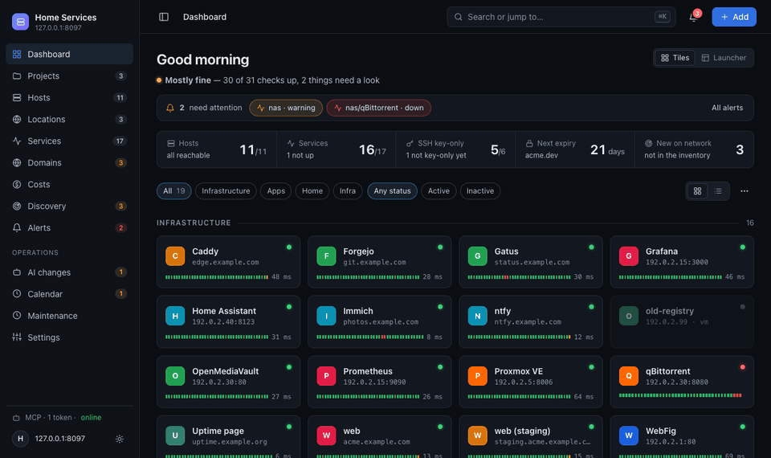<br><sub><b>Jump to anything</b> — press <kbd>Ctrl</kbd>/<kbd>⌘</kbd> + <kbd>K</kbd> to search hosts, services, projects and app links.</sub></td>
<td width="50%">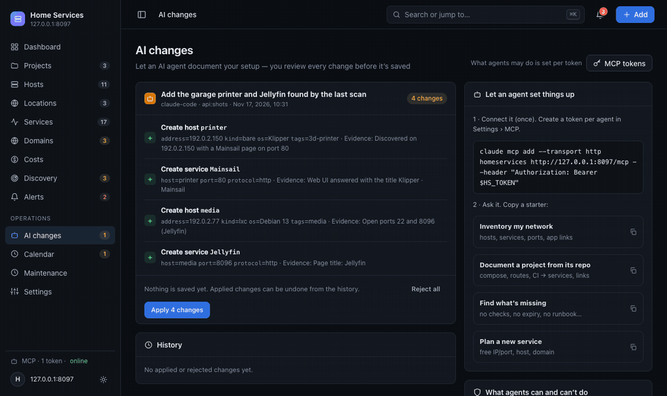<br><sub><b>Review what an agent proposes</b> — every change is listed with its evidence, applied in one click and undoable.</sub></td>
</tr>
</table>

<details open>
<summary><b>Tour of the main pages</b> (animated)</summary>
<br>
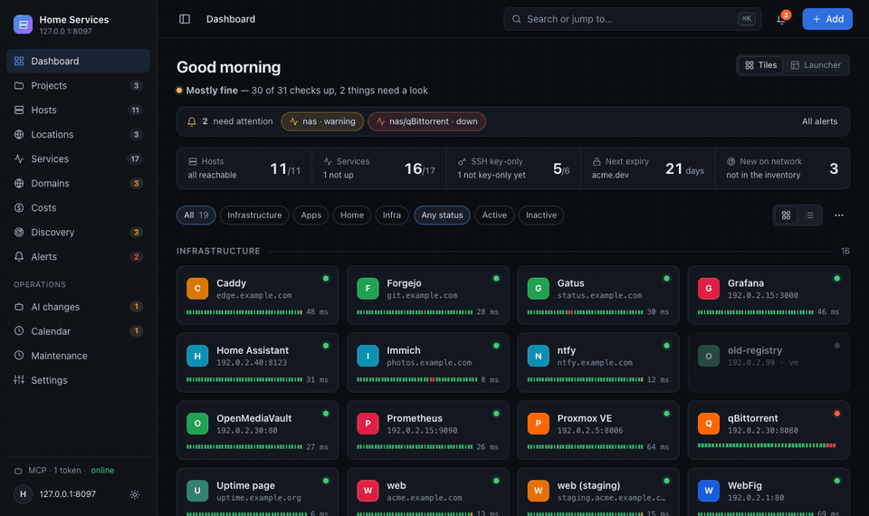
</details>

### Screenshots

<table>
<tr>
<td width="50%"><a href="docs/images/host.png">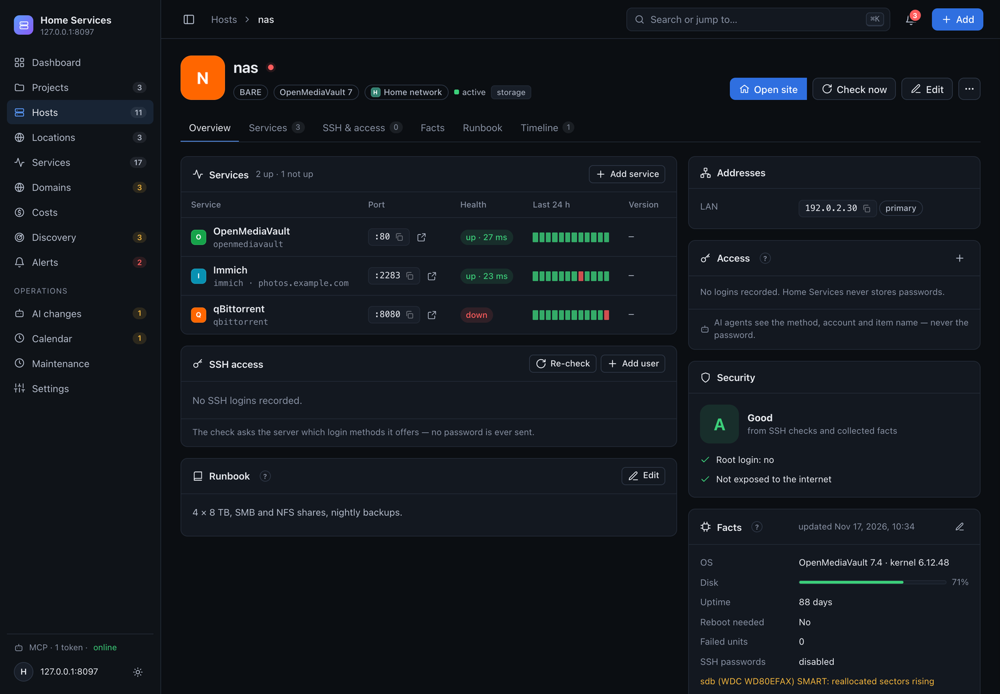</a><br><sub><b>Host</b> — services with live health, SSH posture, facts collected over read-only SSH.</sub></td>
<td width="50%"><a href="docs/images/project.png">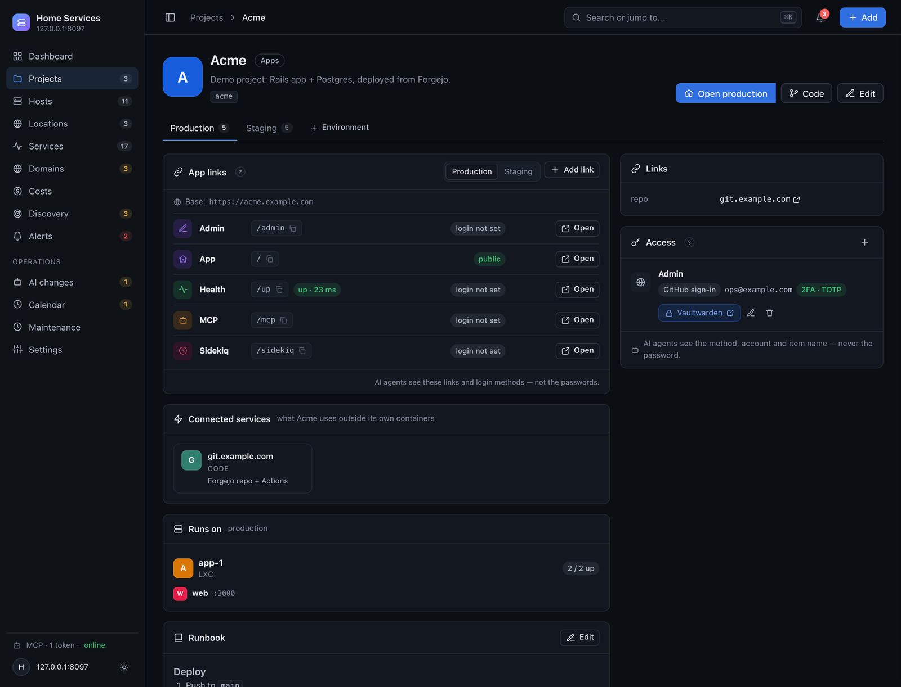</a><br><sub><b>Project</b> — environments, app links (<code>/admin</code>, <code>/sidekiq</code>, <code>/mcp</code>…) and what it depends on.</sub></td>
</tr>
<tr>
<td><a href="docs/images/alerts.png">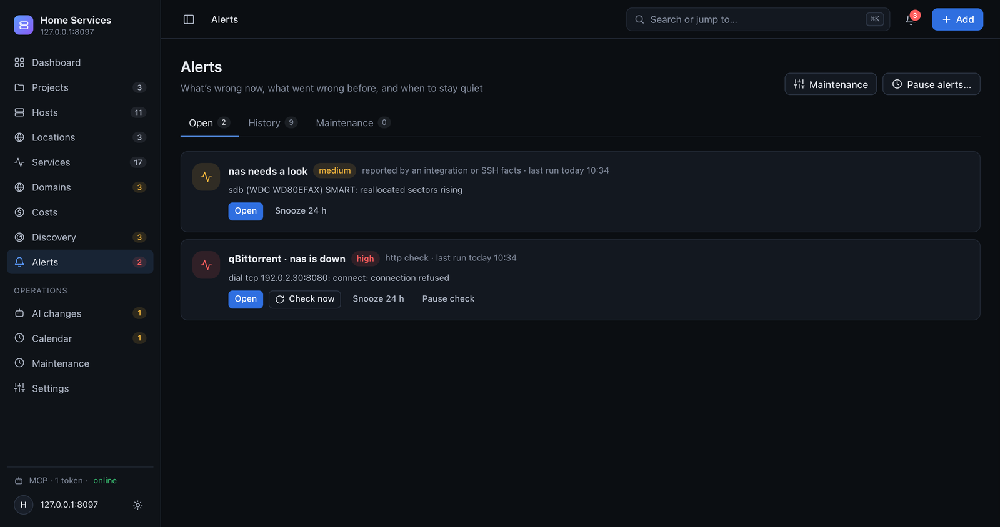</a><br><sub><b>Alerts</b> — what is wrong now, history of incidents, maintenance windows.</sub></td>
<td><a href="docs/images/discovery.png">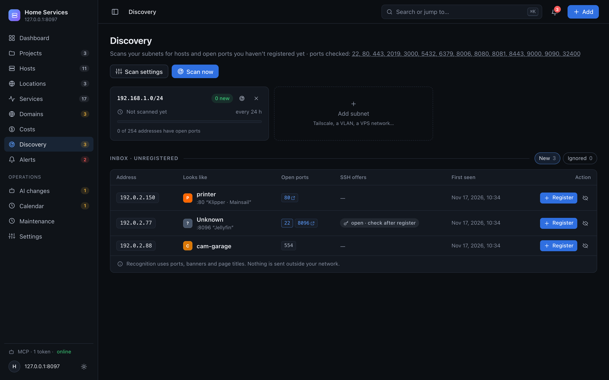</a><br><sub><b>Discovery</b> — new devices on your subnets, recognised by ports and page titles.</sub></td>
</tr>
<tr>
<td><a href="docs/images/integrations.png">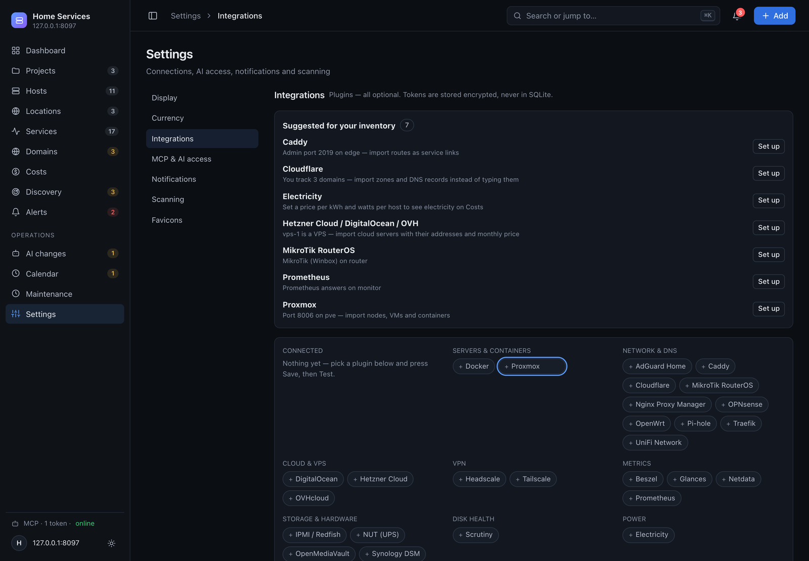</a><br><sub><b>Integrations</b> — pick a plugin, press Test, then Sync. Results arrive as a changeset to review.</sub></td>
<td><a href="docs/images/hosts.png">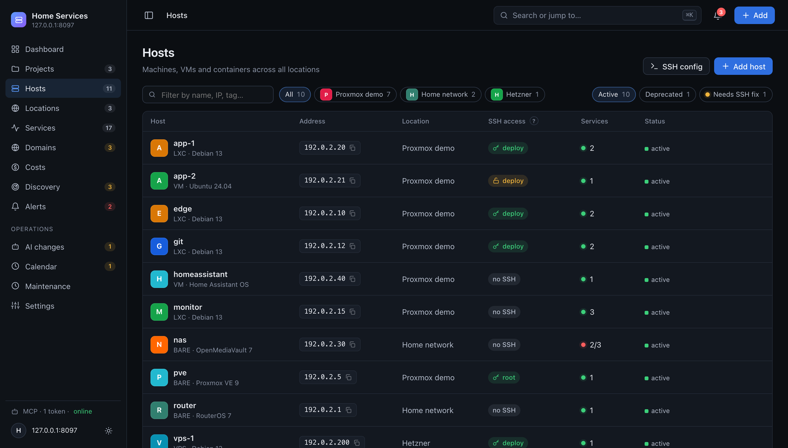</a><br><sub><b>Hosts</b> — filter by location or lifecycle, sort by any column.</sub></td>
</tr>
<tr>
<td><a href="docs/images/launcher.png">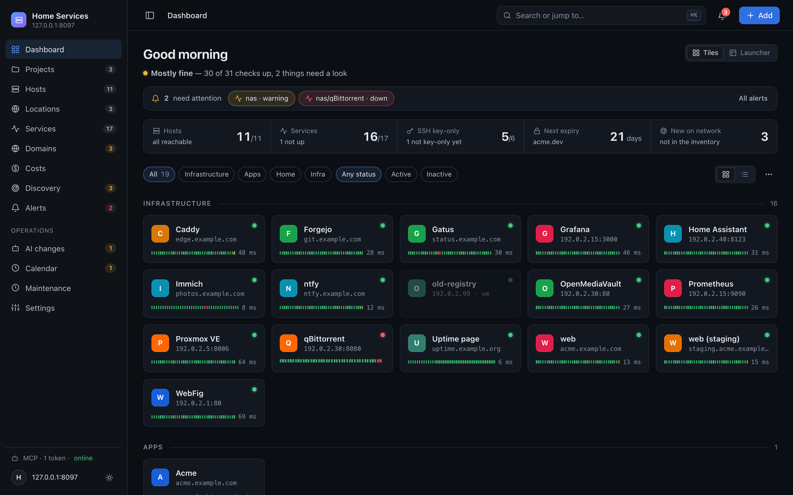</a><br><sub><b>Launcher</b> — a big-icon start page, if you prefer it to tiles.</sub></td>
<td><a href="docs/images/dashboard-light.png">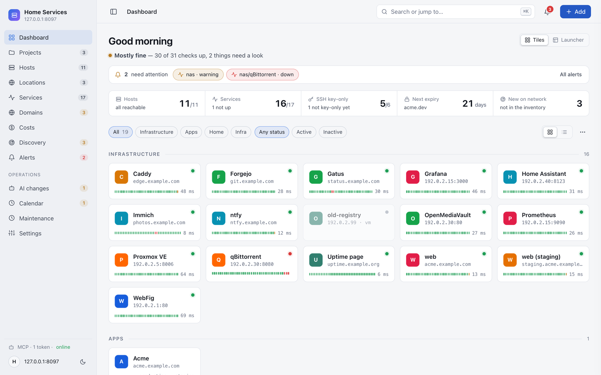</a><br><sub><b>Light and dark</b> themes, plus custom themes from a JSON file.</sub></td>
</tr>
</table>

<p align="center">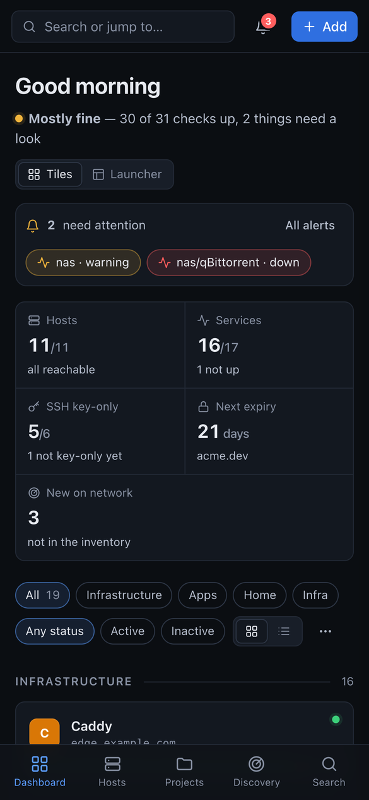&nbsp;&nbsp;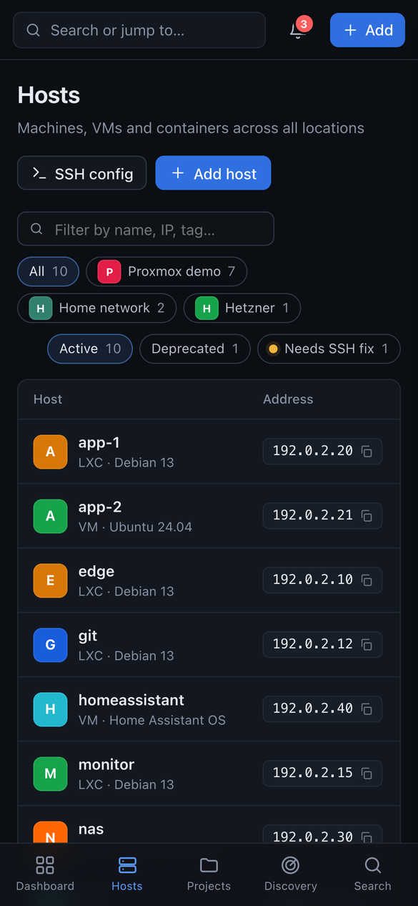<br><sub>Works on a phone too.</sub></p>

## Quick start

### Try it with demo data (30 seconds)

```bash
git clone https://github.com/Dumhouse/homepage.git
cd homepage
make build
HS_DATA=./demo-data ./bin/homeservices demo      # a fictional lab: 11 hosts, 3 projects, …
HS_DATA=./demo-data ./bin/homeservices           # open http://localhost:8080
```

The demo uses addresses from the reserved `192.0.2.0/24` range, so its health checks can never
touch a real network (they will simply show as unreachable).

### Run it for real

<details open>
<summary><b>Docker</b></summary>

```bash
curl -fsSLO https://raw.githubusercontent.com/Dumhouse/homepage/main/compose.yaml
docker compose up -d            # ghcr.io/dumhouse/homepage — http://localhost:8080, data in ./data
```
</details>

<details>
<summary><b>Debian / Ubuntu LXC or VM (systemd)</b></summary>

```bash
git clone https://github.com/Dumhouse/homepage.git && cd homepage
curl -fLo homeservices-linux-amd64 https://github.com/Dumhouse/homepage/releases/latest/download/homeservices-linux-amd64
scp -r homeservices-linux-amd64 deploy root@your-host:/tmp/
ssh root@your-host 'cd /tmp && ./deploy/install.sh ./homeservices-linux-amd64'   # listens on :80
```

Every [release](https://github.com/Dumhouse/homepage/releases) has Linux binaries for **amd64**, **arm64** (Raspberry Pi 4/5)
and **armv7**, with `SHA256SUMS`. Or build them yourself with `make release`.
See the [deployment guide](docs/deployment.md) for updates with automatic rollback, backups and restore.
</details>

<details>
<summary><b>From source</b></summary>

```bash
make test && make build
./bin/homeservices            # http://localhost:8080, data in ./data
```

Needs Go (see `go.mod`). There is nothing else to install — the UI is embedded.
</details>

### Then

1. **Add what you have.** Press **Add**, or open **Discovery** and scan a subnet, or connect an
   [integration](docs/integrations.md) such as Proxmox or Caddy and press *Sync*.
2. **Let it watch.** Services with a port or domain get health checks automatically.
3. **Connect an agent** (optional): see [AI agents](#connect-claude-code-or-another-agent).
4. **Add a notifier** (optional): ntfy, Gotify or a webhook under *Settings › Integrations*.

> **Security:** by default there is **no login** (`HS_AUTH=none`) because the app is meant for a
> trusted network. If anyone untrusted can reach the port, set `HS_AUTH=password`, or `HS_AUTH=proxy` behind your
> single-sign-on proxy — see
> [Security](SECURITY.md).

## Connect Claude Code or another agent

```bash
./bin/homeservices token create --name claude-code --scope propose     # read | propose | write
claude mcp add --transport http homeservices http://localhost:8080/mcp \
  --header "Authorization: Bearer hs_…"
```

- `read` tokens can search and read everything.
- `propose` tokens can also queue **changesets** (add this host, link that service). A human reviews
  and applies them on the *AI changes* page, and can undo them later.
- `write` tokens can change the inventory directly.
- Agents **never** receive passwords: access entries hold a method, an account name and a link to
  the item in Vaultwarden, Bitwarden or whatever you use.

Ask things like *"Inventory my network and propose what's missing"*, *"What breaks if the NAS goes
down?"* or *"Find a free port for a new service on app-1."* More in [AI agents](docs/ai-agents.md).

## Configuration

Everything has a sensible default. The common settings:

| Variable | Default | Meaning |
|---|---|---|
| `HS_ADDR` | `:8080` | listen address |
| `HS_DATA` | `./data` | SQLite file, icon cache, encrypted secrets, backups |
| `HS_AUTH` | `none` | `none` (trusted LAN), `password`, or `proxy` (Authelia, Authentik, oauth2-proxy sign-in) |
| `HS_PASSWORD_HASH` | — | argon2id hash from `homeservices hash-password` |
| `HS_MASTER_KEY` | — | key that encrypts integration secrets (`secrets.enc`) |
| `HS_NTFY_URL` / `HS_WEBHOOK_URL` | — | where alerts go (or use the plugins in the UI) |
| `HS_BACKUP_COPY_TO` / `HS_BACKUP_EXEC` | — | copy each daily backup to a NAS mount or run `rclone` |

All variables, the CLI and per-page settings are in the [configuration reference](docs/configuration.md).

## How it is built

Go · SQLite (pure Go, no CGO) · `html/template` + [htmx](https://htmx.org) · chi · the official MCP Go SDK.
One writer (`inventory.Store`) owns all writes, every change leaves an audit row, deletes are soft,
migrations are append-only. Details in [Architecture](docs/architecture.md).

## Documentation

| | |
|---|---|
| [Getting started](docs/getting-started.md) | install, first run, adding your first things |
| [Concepts](docs/concepts.md) | hosts vs services vs projects, checks, changesets, logins |
| [Integrations](docs/integrations.md) | every plugin, what it needs, how to set it up |
| [AI agents (MCP)](docs/ai-agents.md) | tokens, scopes, tools, example prompts |
| [REST API & exports](docs/api.md) | endpoints, Homepage / Ansible / Prometheus exports |
| [Configuration](docs/configuration.md) | environment variables, CLI, settings pages |
| [Deployment](docs/deployment.md) | systemd, Docker, reverse proxy, backups, updates |
| [Architecture](docs/architecture.md) | packages, ground rules, how to extend |
| [FAQ & troubleshooting](docs/faq.md) | common questions |

## Contributing

Issues and pull requests are welcome — see [CONTRIBUTING.md](CONTRIBUTING.md). The fastest loop is
`make test` and `make run`. New integrations are the most useful contribution: a plugin is one Go
file plus a test with an HTTP fixture ([how](docs/architecture.md#adding-an-integration)).

## License

[AGPL-3.0](LICENSE). If you run a modified version as a network service, you must offer its source
to the users of that service.
