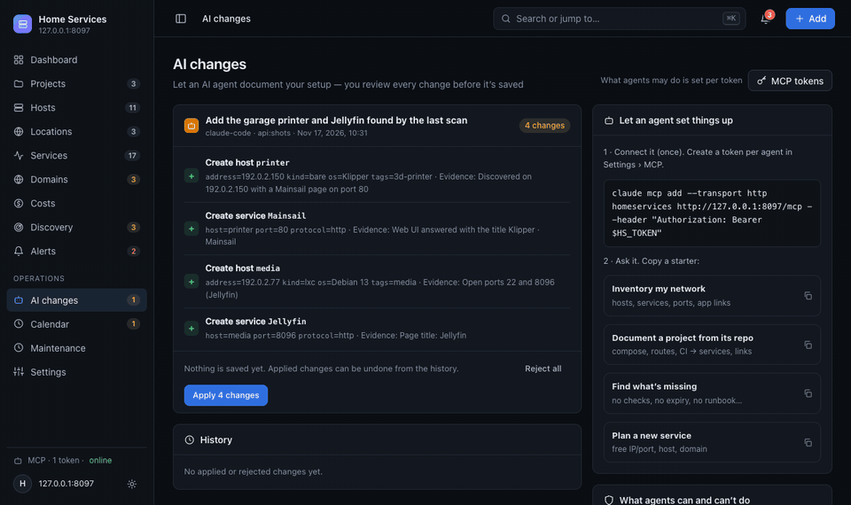

# AI agents (MCP)

Home Services includes an [MCP](https://modelcontextprotocol.io) server, so Claude Code, Claude Desktop or any
MCP client can read your inventory and propose changes. It is built on the idea that **an agent should be able to
document your setup without being able to break it or read a secret.**

## Connect

1. Create a token (shown once — store it in your password manager):

   ```bash
   ./bin/homeservices token create --name claude-code --scope propose
   ```

   or use **Settings → MCP & AI access** in the UI. List and revoke tokens with `token list` / `token revoke <name>`.

2. Register the server. For Claude Code:

   ```bash
   claude mcp add --transport http homeservices http://localhost:8080/mcp \
     --header "Authorization: Bearer hs_…"
   ```

   Any client that supports Streamable HTTP works: URL `http://<host>:8080/mcp`, header
   `Authorization: Bearer <token>`.

## Scopes

| Scope | Can |
|---|---|
| `read` | search and read everything, run checks and probes, list changesets |
| `propose` | everything in `read`, plus queue **changesets** (`propose_changes`, `request_connection`) |
| `write` | everything above, plus create, update and delete directly |

Give an agent the smallest scope that does its job. `propose` is the sweet spot: the agent does the legwork,
you press **Apply**.



## What agents never get

- **Passwords, tokens and keys.** Access entries hold a method, an account and a *link* to your password manager.
- **Integration secrets.** They live encrypted outside the database and are not exposed over MCP or the API.
- **Hard deletes.** Everything an agent deletes is a soft delete you can restore.

## Tools

42 tools with a `write` token (fewer for `read` / `propose`). Highlights:

| Area | Tools |
|---|---|
| Look things up | `search`, `list_hosts`, `get_host`, `list_services`, `list_projects`, `get_project`, `list_locations`, `list_tags` |
| Understand impact | `used_by` ("what breaks if this is down?"), `list_problems`, `list_checks` |
| Probe | `detect` (fingerprint an address or URL), `check_service`, `check_ssh`, `run_check` |
| Plan | `suggest_free_port`, `suggest_plugins` |
| Propose | `propose_changes`, `request_connection`, `list_changesets`, `get_changeset` |
| Edit (`write`) | `create_host`, `update_host`, `add_service`, `update_service`, `add_ssh_access`, `add_access`, `create_project`, `add_project_env`, `add_app_link`, `link_project`, `connect_service`, `delete_*`, `restore` |

Read-only resources are also available: hosts and projects as Markdown, and **`/inventory.md`** — one plain-text
document with the whole inventory, which works with any agent that can fetch a URL with the token.

## Example prompts

- *"Inventory my network: scan, then propose the hosts and services that are missing."*
- *"Read this repo's `docker-compose.yml` and `Caddyfile` and propose a project with its services and app links."*
- *"What breaks if `nas` goes down?"*
- *"Which services have no health check, and which domains expire in the next 60 days?"*
- *"Find a free port on `app-1` for a new service and propose it."*

The **AI changes** page also has copy-ready starters for these.

## How a proposal looks

```json
{
  "title": "Add the garage printer found by the last scan",
  "source": "claude-code",
  "ops": [
    { "action": "create", "entity": "host",    "ref": "printer",
      "data": { "kind": "bare", "address": "192.168.1.50", "os": "Klipper" },
      "note": "Mainsail page on port 80" },
    { "action": "create", "entity": "service", "ref": "Mainsail",
      "data": { "host": "printer", "port": "80", "protocol": "http" } }
  ]
}
```

A human sees each op with its note as evidence, applies the set (or rejects it), and can undo it afterwards.
The same call is available over REST: `POST /api/v1/changesets` ([API](api.md)).
